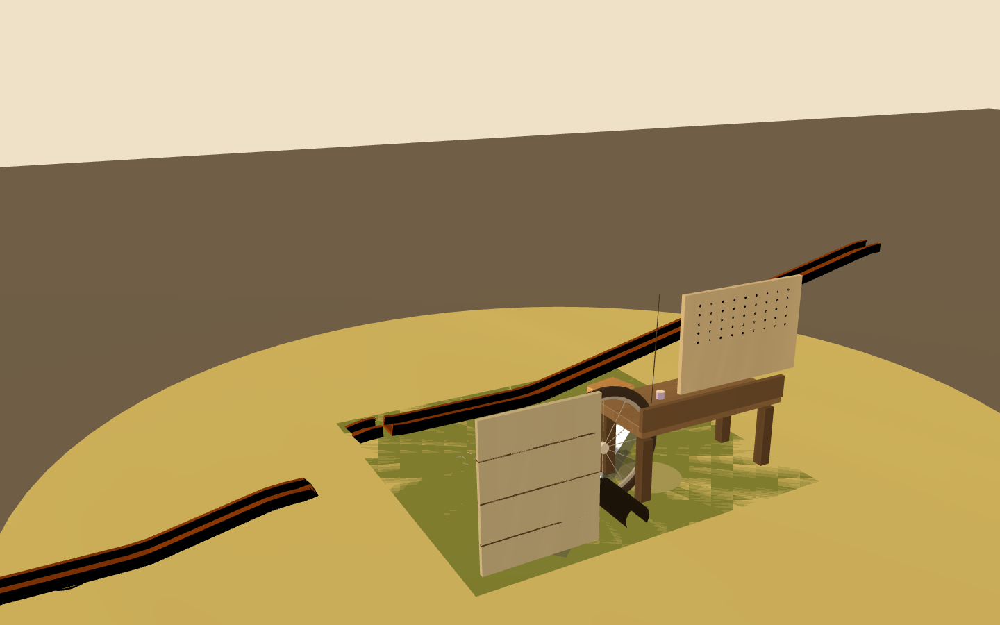
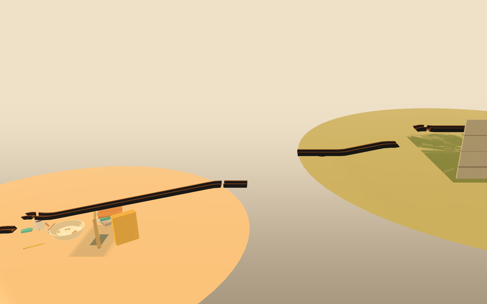
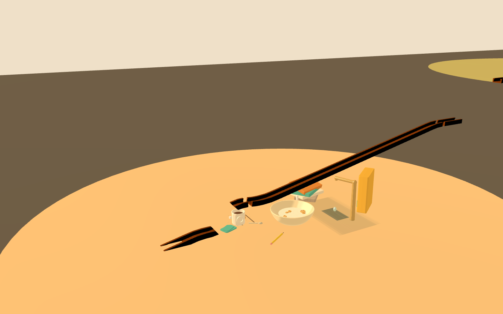
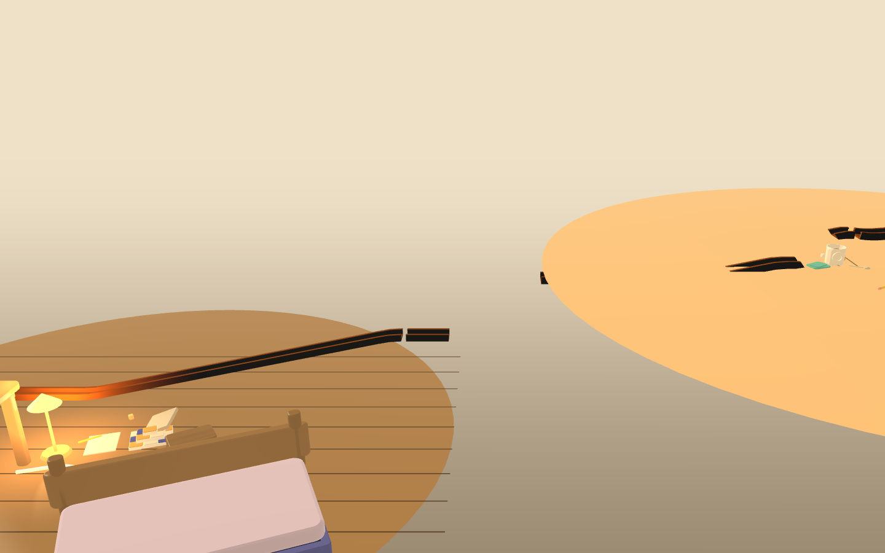
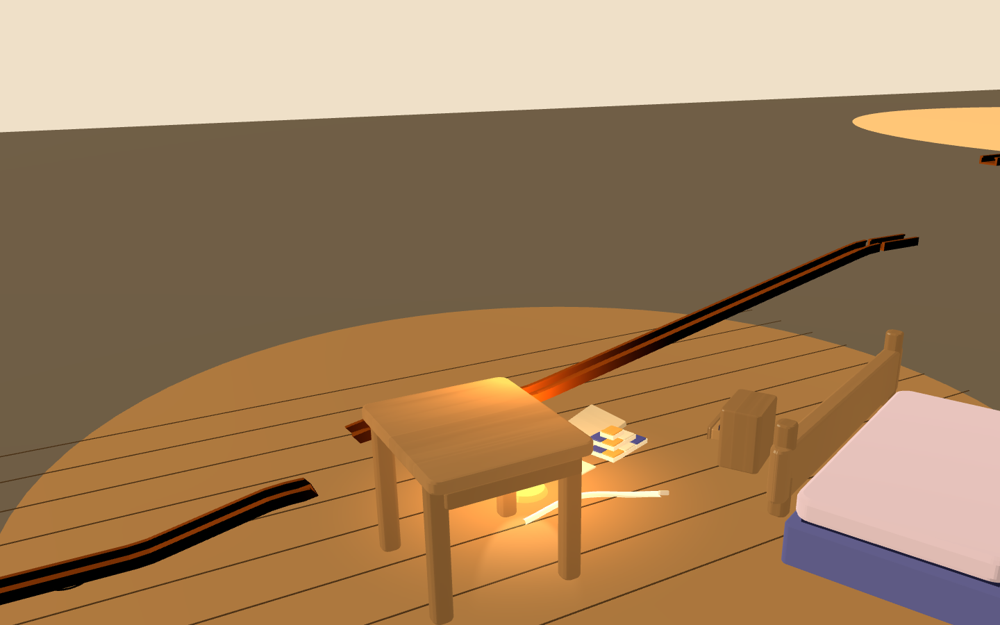
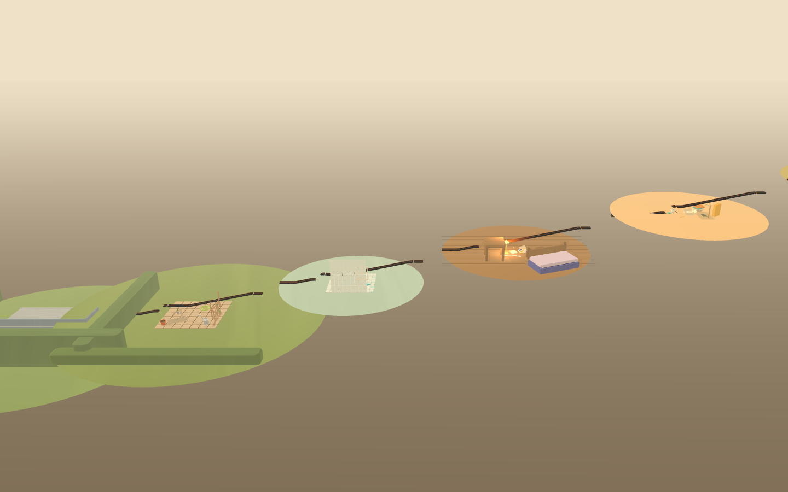

# Downhill Spike (Lane A, branch `fp-downhill`)

> [!abstract] Role
> Systems spike for candidate A of [[Concepts/Freeplay Exploration]] (the DOWNHILL), per
> `Reference/Action Plan 2026-10-12` Lane A: the house frame table, the six ratified sets at frame
> positions with authored drop-and-catch connectors as fixtures, one car launched from the garage
> mezzanine under THE INPUT LAW, THE NUMBER = rooms physics approves on the way down, hashed twice;
> plus the house camera law study and frame cost. **Headline: median rooms approved across the sweep
> = 4 (RANGE 2..6, 15 runs; a 6/6 full house exists). The ≥3 physics gate PASSES; the Lane B
> re-probe is PENDING, so the greenlight is CONDITIONAL.** Nothing ships; branch never merges;
> `npm run replay:all` = 30 rungs verified byte-same at every checkpoint — the spike ADDS files
> only (`tools/spike-downhill.mjs`, `tools/spike-downhill-gl.mjs`, `src/dev/scenes/downhill.ts`,
> `src/dev/scenes/downhill-frame.ts`, `tools/spike-freehouse-core.mjs`) and edits no shipped file
> (the only edit is to the spike file `tools/spike-freehouse.mjs`, whose `FreeHouse` instrument was
> extracted verbatim into the core — kitchen01's `d32417dc` still reproduces bit-for-bit, check D0).

## 1. THE HOUSE FRAME table (six decks, porch 0 → garage mezzanine top)

Derived from the campaign's y-statistics (30 rungs + 6 sandboxes; `finishDeckY` = the par build's
`finishCup` in-socket y, the `tests/unit/*-levels.test.ts` law; `placeY` = the room's `setPlacement`
row median). **The campaign table is FLAT** — every room's floors sit within ~0.06 m of y = −0.45
and every rung starts at y ≈ −0.007 and finishes ~0.44 m lower. What the data supplies is the
room's INTERNAL descent: each room is authored ≈ 0.44 m tall. The frame canonises that:

| room | placeY med | finishDeckY med | internalDrop med | **canonical altitude (m)** |
| --- | --- | --- | --- | --- |
| garage | −0.4481 | −0.4207 | 0.4363 | **3.432** (mezzanine top = launch) |
| kitchen | −0.3981 | −0.4431 | 0.4736 | **2.745** |
| bedroom | −0.4481 | −0.4431 | 0.4563 | **2.059** |
| bathroom | −0.4481 | −0.4207 | 0.4363 | **1.373** |
| garden | −0.4541 | −0.4207 | 0.4363 | **0.686** |
| porch | −0.3247 | −0.3147 | 0.3507 | **0.000** (floor of the world) |

Six numbers = `(5 − rank) × STEP`, `STEP = INTERNAL_DROP + dropH = 0.4363 + 0.25 = 0.686 m`, rank
by the prose ladder (garage bench → kitchen counter → bedroom shelf → bathroom tile → garden
paving → porch planks), `dropH` = one kit-default `drop` height (`0.25`, `src/track/pieces.ts`).
The six ratified sets (the 04 `parBuild`s, as in the feasibility scatter-parcel layout) sit on a
descending +x line at those altitudes, set groups mounted by each room's own `placeY` statistic
(the campaign's `placeSet` rule), the world floor slab top at −0.75 (physical group `0x0001_ffff`,
the tunnel law of [[Reference/Freeplay Feasibility]] §1). Connectors are FIXTURES: one `straight`
run-out, one authored `drop` piece (height = exit y − next entry y ≈ `dropH`, ballistic gap only —
the steering veto holds, no `curve`/`bank` anywhere), one run-in seating 2 cm off the next deck's
entry socket. No campaign level data is touched; each 04 build keeps its authored geometry (a
house is a NEW id; its receipts are its own).

## 2. THE NUMBER

One car, garage mezzanine, step-keyed wind (the `FreeHouse` wind: every 60th step, governor 2.5 m/s
— the existence-proof input law; launch 0.4 m/s). APPROVED = that room's own 04 `finishCup` under
the FULL `World.observe` law (moving capture `CUP_CAPTURE_FACTOR`·r, or the stall branch radius +
`CAR.halfL`), read-only pose probe (hash-neutral, Feasibility T4 pattern). 30 s per run.

**Main run (canonical frame): rooms approved 4/6 — garage@1.0s → kitchen@1.9s → bedroom@2.8s →
bathroom@3.7s. Hashed twice: `bdeeee29` = `bdeeee29`, approval-stream hash `6a404214` = `6a404214`
— bit-stable; the run IS its own receipt (the whole 30 s trajectory hashes identically, so this
states bit-stability directly, and the D0 kitchen01 check pins the stepper to the shipped engine).**

Sweep = launch window (mezzanine release x-offset 0 / 0.25 / 0.5 m — which window you drop from) ×
deck grade (`dropH` 0.15 / 0.25 / 0.40 at leg angle 40°, plus `dropH` 0.25 at 50° and 60°) = 15 runs:

| rooms | 2 | 3 | 4 | 5 | 6 |
| --- | --- | --- | --- | --- | --- |
| runs | 1 | 2 | 5 | 6 | 1 |

**THE NUMBER = 4 median; RANGE 2..6.** 13/15 runs ≥ 3. The 6/6 full house exists: drop 0.25 @ leg
angle **50°**, window 0 (hash `8d3dd6eb`) — every room's own cup approves in 4.8 s. Wind-off probe:
**1/6** — gravity alone dies in the garage; the input law is not optional. Approvals all land in
the first ~5 s; the 30-s tail is rollout across the world floor.

Engineering findings the product must inherit: (a) at downhill exit speeds (5–9 m/s) the car can
skate OVER a deck entry and slide UNDER it — the raycast-suspension reach law of Feasibility §1,
now measured deck-to-deck; a thin run-in misses, a steeper leg catches (the 50° result). (b) A
campaign-style `landing` trough AFTER the drop makes it WORSE (1/6 across the grid) — the 40°→8°
incidence beats the suspension; the `drop` piece's own catch arc is the right catch. (c) The
PORCH's own finish cup is the hardest threshold (approved in 1/15 — the drain room's cup is
drive-past geometry at downhill speed); the bottom deck wants an authored catch, not a cup at the
rail's end. (d) 60° legs flake at low windows (2/6) — grade and angle co-tune.

## 3. The house camera law (crane + room-hand-off)

The room-graph the law rides is the layout's: 6 nodes (deck centres + altitudes), 5 edges (legs) —
`roomGraph` in `src/dev/scenes/downhill-frame.ts`. The grammar is already shipped: the farewell
crane's DWELL→MOVE plan (`CRANE_DWELL` / `CRANE_MOVE`, `craneAtmosphere`, `CRANE_HAZE` in
`src/pages/farewell.ts`) made SPATIAL — dwell on a deck, lift-and-walk the leg while the haze
rides the sine, dock into the next room at a lower altitude (the farewell's `craneRoomX` is a flat
ROW; the house's is a STAIR). Two hand-written hand-offs captured (dwell / leg / dwell):

Hand-off A, garage → kitchen — dock, leg (fog at `CRANE_HAZE.density`), dock:

Hand-off B, kitchen → bedroom — leg and dock:

The whole section (menu-camera candidate):

What reads, and what it costs: the DOWNHILL finally reads in the crane shot — the decks' differing
altitudes make the farewell-crane "speckle in beige void" problem materially better (compare the
flat parcel field in [[Reference/Freeplay Feasibility]] §1), and the fog legs sell the between.
What does NOT read yet is exactly what the campaign cameras hide per-set: floating floor discs
between sets, prop undersides, and the void under the stair. Product cost, stated plainly: a
`RunCamera`-sized NEW module — a house camera PLANNER (waypoints from the room-graph, dwell/move
timings lifted from the farewell plan) + per-deck framing canon (the six sets' `shots` re-aimed at
deck altitudes) + a house-wide solids set (`setCameraSolids` is per-set today) + the cross-section
dressing the AD would author for the home screen anyway (Candidate A's surfaces section). That is
design-forward work measured in a focused pass per room plus one planner module — REAL, not a
retune, and it is the same fog the round-3 tail already asked to be painted.

## 4. Frame cost (hardware GL, Apple M5 Pro, `--use-angle=metal`, serialised frames @ 960×540)

| scene | render ms | draws | tris |
| --- | --- | --- | --- |
| one room (kitchen-set hero) | 2.1 med / 3.4 p95 | 148 | 47 k |
| THE DOWNHILL (6 decks + 5 connector legs + crane haze) | **3.5 med / 4.8 p95** | 418 | 237 k |

Vsync-comfortable with margin — the connectors+fog frame costs +1.4 ms over one room; the whole
frame renders for less than a 6-room campaign montage would. Headless: 0.048–0.088 ms/step
(~110–170× realtime single-threaded), same class as the feasibility house.

## 5. Greenlight recommendation (against the plan's gate)

Gate = THE NUMBER ≥ 3 **AND** the Lane B re-probe's verdict that the tally sheet holds attention.

- **≥3 rooms: PASS.** Median 4 across a launch-window × deck-grade sweep; 13/15 runs ≥ 3; a 6/6
  full house exists and hashes (`8d3dd6eb`). Physics approves a whole-house descent with only
  fixture geometry and the input law — steering veto intact, every new id append-only.
- **Lane B: PENDING.** No B session note exists in the vault yet (checked `Sessions/` — nothing
  for the tally program); the AND-clause cannot be evaluated from here.

**Recommendation: greenlight A for the Decision Log entry, CONDITIONAL on B's re-probe.** The
irreversibilities named in the plan still stand as written: deck altitudes (the table above) become
canon the day the entry lands — log them VERBATIM before the connector-authoring pass; the porch
finding (§2c) is the one frame-table amendment the connector pass must design around.

## Reproduction / honesty

Branch `fp-downhill` (never merged), ports 4931+. `node tools/spike-downhill.mjs` prints D0–D4;
`node tools/spike-downhill-gl.mjs` builds, serves, measures, and re-captures the six camera shots
(aborts on software GL). D0's kitchen01 `d32417dc` is the instrument's honesty check.
`npm run replay:all`: 30 rungs verified at every checkpoint — byte-same, because the spike touches
no shipped file (its only edit is `tools/spike-freehouse.mjs` → core extraction, T-outputs
unchanged). Known blemish inherited from main, untouched: `src/dev/scenes/freehouse.ts` carries a
`parBuild` optional-call typecheck error predating this branch.
