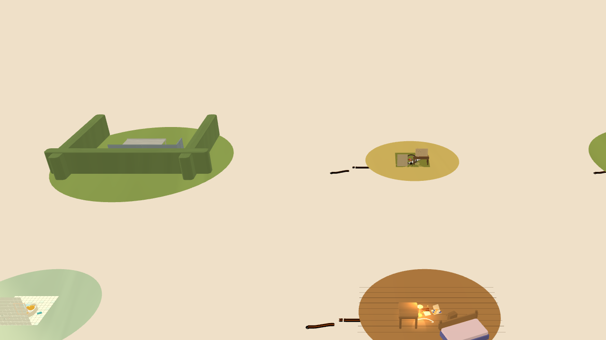

# Freeplay Feasibility (the whole-house spike, branch `eng-free`)

> [!abstract] Role
> Systems-engineering spike for the director's question: **can this engine support a FREE-FORM experience instead of the 30-rung ladder, and at what cost?** Nothing here ships — two spike commits on `eng-free` (`ca1c4f9` headless, `a632412` hardware GL) measure the five asks. Headline, as measured: the hash machinery survives a whole-house world exactly; the ladder does NOT survive being laid INTO that world byte-compatibly; and the ONE thing free-form needs is not an anchor in the world but an **input law** in the receipt.

Spikes: `tools/spike-freehouse.mjs` (T0–T6, headless Node) and `tools/spike-freehouse-gl.mjs` + harness scene `src/dev/scenes/freehouse.ts` (hardware GL, `--use-angle=metal`, Apple M5 Pro). The spike's instrument, `FreeHouse`, is the `World` system order (launchers → `carStep` → `applyRollingResistance` → `stepWorld` → `hashBodies` on `HASH_INTERVAL`) with the outcome block removed and a step-keyed deterministic wind standing in for player throttle — and it is PROVEN the same machine: it reproduces kitchen01's shipped par hash bit-for-bit (`d32417dc`, 268 steps, T0).

## 1. Whole-house continuous world — physics CHEAP, camera law REAL, hash machinery CHEAP

All six sets' 04 par builds laid into one `World`-shaped world on a 3×2 parcel grid, plus one floor slab.

| Measured | Value |
| --- | --- |
| World extent (track AABB) | 18.4 × 0.44 × 7.0 m (parcels at x 4..20, z 0..7) |
| Bodies / colliders | 7 static bodies (6 rooms + floor) + 5 dynamic (chassis + 4 wheels); 705 track colliders + 1 floor |
| 5-min cross-house replay (36 000 steps), run twice | hashes EQUAL (`2f2c2d93`), 6/6 rooms on the path, positions spanned x 2.30..22.34 m |
| Sim cost | 0.059 ms/step ≈ **140–195× realtime** single-threaded; one-room world same stepper 0.020 ms/step → house/one-room ratio **≈ 3** |
| Hardware GL, serialised frames @ 960×540 | one room 2.0 ms median (148 draws, 47 k tris) vs **whole house 3.4 ms median / 4.0 p95** (378 draws, 220 k tris) — both vsync-comfortable |

Determinism verdict: **the hash survives the bigger AABB.** `quant`'s 32-bit fold wraps at 2^31·10⁻⁴ = 214 748 sim m = **21 km world** — house scale sits three orders of magnitude inside it, and the empirical double-run is bit-stable. Two laws the spike discovered and a product implementation must keep: (a) the floor must be a **physical-group** collider (`0x0001_ffff`, the `addStaticBoxes` family) — a TRACK_GROUP floor is invisible to the raycast chassis, and the suspension rays' 0.26-sim reach is shorter than a fast fall's per-step travel, so a track-group floor is TUNNELLED (measured: a car that fell through reached y = −11 890 m with an otherwise-identical hash); (b) world coordinates must stay bounded by design — the wrap is a hash law, not a warning.

Camera verdict: **real cost.** `RunCamera` is rail-arc machinery and every canonical camera is per-set; a free world has no rail. The house crane () shows the grammar problem plainly — six floor discs marooned in beige void, prop scale collapsed to speckle. A house camera law (crane + room-hand-off, probably a room-graph the set parcels already imply) is new design work, not a retune. Frame cost itself: cheap (3.4 ms).

## 2. Player-proposed goals — verdict machinery CHEAP, scoring semantics REAL

The verdict block in `World.observe` reads the cup from the BUILD (any `finishCup` piece's `captureVolume`), not from an authored socket — the cup is already player-placed geometry; the rung merely fences the tray. Spike (T5): a cup at a measured mid-run path point CAPTURES at t = 67.18 s; a cup floating mid-garage is honestly REFUSED (run stays `open`/timeout); a cup at the line captures at t = 0.01 s. The physics approves/refuses exactly as advertised, anywhere in the house. The placement affordance is the builder's existing ghost/guard layer (the `blockedGoalSeat` precedent: placement law adds no collider and moves no hash). What breaks are the ECONOMY words: **pars** become player-declared — the honest mechanic already exists as `gen-pars`' rule ("par = the measured replay of a reference build") applied to the player's own reference run; **stars** re-base onto personal best; **ghosts** are unaffected — `TapeRecorder` already records your runs step-for-step and `replayRun({record:true})` yields the identical list, so "the ghost is your best run" is a save-schema statement, not a physics one. Cost: affordance cheap, semantics real (it is a design decision wearing an engineering hat).

## 3. Trick detection — CHEAP

Read-only probes over `TraceSample` lists (air time > 0.25 s, room parcel crossings, chain falls from dy-drop runs): a 5-minute house trace yields 7 events for **~1.4 ms** of derivation; the event stream hashes identically across runs (`329387b2` ×2, from bit-stable traces); and the audio-firewall pattern holds by measurement — a probe reading `state()` INLINE every step leaves the run hash untouched (`34475023` with and without), because events derive from poses and never enter `hashedBodies`. Same discipline as `src/juice/layer.ts` and the car rig: read the poses, own no bodies, never step anything. Verdict: cheap, and deterministic for free IF detectors stay pure functions of the recorded trace (deriving them inside the step loop from live bodies would work but buys nothing and adds a temptation).

## 4. Campaign-as-data migration — STRUCTURAL, and the reason is not what one would guess

Two experiments (T3), each rung's `parBuild` replayed against its shipped-hash run:

- **Extra geometry is free**: all **30/30** rungs hash byte-identically with the other five rooms' colliders parked in the same world 6–16 m away. The solver is indifferent to far statics — the house's size is not the obstacle.
- **Absolute geometry is the obstacle**: the SAME build translated +0.5 m or +5 m moves every hash (`d32417dc` → `6dee67d3` / `dffa774b`; 0/2 preserved). The hash is a function of where the geometry SITS, not merely of what it is.

So the 30 rungs are not representable as goal-markers in one coherent walkable house without re-deriving a single hash — their tracks occupy overlapping volumes around the origin and any re-siting re-mints their receipts. The CLOSEST byte-compatible representation is the measured one: a **scatter-parcel house** — every rung's track kept at its authored world coordinates, rooms coexisting hash-neutrally in the same world. Byte-identical (proved 30/30), but honest description: a field of thirty islands with the room dressing around them, not a house one walks between rungs. The migration is structural (campaign data would have to carry per-rung world identities, or accept per-rung pocket dimensions — an authored-pocket-per-rung design, which is the shipped game wearing a hub).

## 5. Save/share payload growth — CHEAP, with one link-budget asterisk

Measured wire sizes (canonical JSON → deflate-raw → base64url): shipped share fragments 328 / ~455 / 756 chars (min/med/max of all 30 rungs). The house itself costs **nothing** in payloads — sets are code-side generated, never serialised; freeform 3-D placement pays the same ~143 B/piece as chained placement before compression (transforms are Mat4 either way), 200 free pieces = 7.1 KiB wire, or 1.8 KiB with a compact 0.1 mm+yaw encoding. The real growth is the **whole-run ghost trace**: a 5-min house trace at 10-step sampling is 304 KiB raw / **144 KiB wire** — comfortable for `localStorage` saves, over the comfortable URL fragment budget (single-digit-KiB) for links. Verdict: house-scale SHARES need trace compaction (delta-quantised poses, ~8–12 B/sample → ~10–15 KiB wire) or "build + seed, replay server-side" links; house-scale SAVES are fine as they are.

## The one thing (the hash law's answer to "a free world needs no anchor")

A whole-house run hash CAN serve as its own receipt — the spike's every 5-minute house run IS that receipt, stable across repeats with no ladder underneath it. But the hash is f(world geometry in absolute coordinates, seed, and the EXACT step sequence of what pushed the car), so the one thing that must be true for free-form to ship honestly is an **input law**: every player action that can move the car (throttle, steers, goal placements, wind, anything) must live in the replayed data as a deterministic, step-keyed stream — the spike's step-keyed wind is the existence proof — and the world's coordinates must stay inside the quantisation bounds. Freedom recorded as data replays bit-exactly and its hash is its own receipt; freedom as live, unrecorded forces is unreplayable and its hash verifies nothing. A free world needs no anchor; it needs a TAPE.

## Reproduction

Branch `eng-free` (never merged): `node tools/spike-freehouse.mjs` prints T0–T6; `node tools/spike-freehouse-gl.mjs` builds, serves, and prints the two frame-cost lines (aborts on software GL). The headless T0 line is the instrument's honesty check — re-run it after any engine change before trusting the rest. No shipped file, anchor, or hash was touched by either commit.
